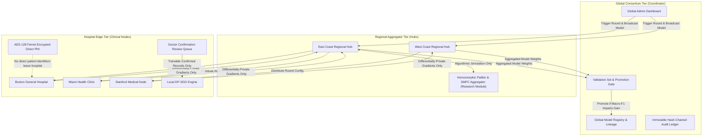

# TrustFed-Health (v2.0 Production Release)

**Privacy-Preserving, Explainable, Fairness-Audited Hierarchical Federated Clinical AI**

TrustFed-Health is an enterprise-grade federated learning platform for multi-condition general disease differential diagnosis. It connects healthcare institutions across a three-tier architecture (**Hospital Nodes** $\longrightarrow$ **Regional Hubs** $\longrightarrow$ **Global Consortium Coordinator**), allowing hospitals to collaboratively train clinical AI models while maintaining zero egress of identifiable patient health information.

[](https://github.com/koshik2005/TrustFed)
[](https://frontend-3qgo.vercel.app/)
[](https://trustfed-backend.onrender.com/health)
[]()

---

## 0. Deployment Modes: Informational vs. Clinical

TrustFed operates under a dual-mode operational architecture designed to ensure full regulatory and safety separation between public/educational prototypes and production hospital deployments:

```mermaid
flowchart LR
    Mode{"APP_MODE"}
    Mode -->|informational (Default)| Info["Informational Mode\n• Educational Decision Support\n• Zero Patient PHI (Names/Contacts Blocked)\n• Persistent Emergency Disclaimer\n• Doctor Confirmation & Training Disabled\n• Permissive Startup"]
    Mode -->|clinical (Explicit)| Clin["Clinical Mode\n• Multi-Tenant Hospital Integration\n• AES-256 Encrypted Patient PHI\n• Doctor Confirmation & Trainable Marking\n• Hierarchical DP Federated Learning\n• Strict Enterprise Preflight Checks"]
```

### Mode Comparison Matrix

| Capability / Boundary | Informational Mode (`APP_MODE=informational`) | Clinical Mode (`APP_MODE=clinical`) |
| :--- | :--- | :--- |
| **Intended Use** | Educational decision-support prototype. | Multi-hospital federated clinical deployment. |
| **Validation Status** | **Not clinically validated. Not medical advice.** | Verified on institutional clinical cohorts. |
| **Patient Identifiers** | **Blocked.** No names or contacts collected or stored. Form fields hidden. | Permitted with AES-256 field-level encryption at rest. |
| **Demographic Intake** | Anonymous tokens (`ANON-XXXX`), age band, sex, symptoms, vitals. | Hospital identifier (`PT-XXXX`), full clinical encounter record. |
| **Doctor Confirmation** | **Disabled & Hidden.** Encounters cannot be confirmed. | **Enabled.** Licensed physicians confirm diagnoses and mark records trainable. |
| **Federated Training** | **Disabled & Hidden.** Rounds cannot be triggered. | **Enabled.** Hierarchical DP-SGD federation across hubs. |
| **Persistent Disclaimer** | Displayed on every page, result card, and API endpoint. | Standard clinical decision support notice. |
| **Startup Preflight Gate** | Permissive: runs on local SQLite or cloud DB for demos. | **Strict Failure Gate.** Startup aborts if any requirement is unfulfilled. |

### Enabling Clinical Mode: Enterprise Preflight Requirements

Before `APP_MODE=clinical` can be deployed, the backend performs a cryptographic and operational preflight check. It will **REFUSE TO START** (`RuntimeError`) unless all of the following flags are satisfied:

1. **`MANAGED_DB_BACKUPS_CONFIRMED=true`**: Confirms that PostgreSQL is running on a managed enterprise cluster (e.g. Supabase, AWS RDS, Neon) with automated daily backups and Point-In-Time Recovery (PITR). SQLite is strictly prohibited.
2. **`MFA_REQUIRED=true`**: Confirms that Multi-Factor Authentication is enforced across all medical staff and administrative accounts.
3. **`ALLOW_DEMO_USERS=false`**: Prohibits 1-click test credentials and hardcoded demo passwords (`DEMO_USERS` seeding is bypassed).
4. **`PATIENT_ENCRYPTION_KEY` & `SECRETS_STORE_MANAGED=true`**: Valid 32-byte URL-safe base64 encryption key confirmed to originate from a persistent enterprise secrets manager (e.g. AWS Secrets Manager, Render Persistent Secrets, HashiCorp Vault).

---

## 1. Architectural Topology & Hierarchy

TrustFed-Health operates across three distinct operational tiers to strictly segregate sensitive clinical data from federated aggregation:



---

## 2. Data Flow: What Leaves Each Tier

No direct patient identifiers leave the hospital under any circumstances. Raw patient names, phone numbers, and contacts remain strictly isolated.

| Operational Tier | What Enters | What Stays Isolated Inside | What Leaves | Destination |
| :--- | :--- | :--- | :--- | :--- |
| **Hospital Node** | Global model parameters ($W, b$), symptom vocabulary, clinical intake. | **Patient Name, Phone, Email** (encrypted at rest via AES-128 Fernet), raw symptoms, vitals, unstructured notes, patient IDs (`PT-XXXX`). | **Only clipped, differentially private weight updates** ($\Delta W_i, \Delta b_i$) and masked model contribution metrics. | Regional Hub |
| **Regional Hub** | Local hospital gradient updates ($\Delta W_i$), training eligibility flags. | Hospital-specific update shares prior to SMPC completion, jurisdictional access tokens. | **Regionally aggregated model weights** ($\overline{W}_{\text{reg}}$) and regional Macro-F1 / accuracy metrics. *(Note: Live web REST tier executes FedAvg over DP-perturbed updates; packed Paillier HE is an algorithmic research simulation module implemented in `backend/tefl/secagg.py`).* | Global Coordinator |
| **Global Coordinator** | Regional model weights ($\overline{W}_{\text{reg}}$). | Held-out validation cohort ($N=216$, Macro-F1: 0.572, Top-3: 86.1%), cryptographic audit verification proofs. | **Signed candidate global model release** ($W_{\text{global}}$) and broadcast rollback instructions. | All Regional Hubs & Hospitals |

---

## 3. Tiered Role-Based Access Control (RBAC)

TrustFed enforces a four-tier access control matrix with strict object-level tenant isolation:

| Feature / Workspace | Hospital Staff (`hospital_staff`) | Licensed Doctor (`doctor`) | Regional Admin (`regional_admin`) | Global Admin (`global_admin`) | Security Enforcement |
| :--- | :---: | :---: | :---: | :---: | :--- |
| **Patient Registration & Intake** | Full Access | Full Access | 403 Forbidden | Read-Only Audit | Scoped to user's `hospital_id` |
| **Run Top-3 AI Differential** | Full Access | Full Access | 403 Forbidden | Full Access | Scoped to active model version |
| **Doctor Review & Confirmation** | 403 Forbidden | **Full Access** | 403 Forbidden | Read-Only Audit | Only doctors can mark encounters trainable |
| **Right to Erasure (Data Retention)** | Full Access | Full Access | 403 Forbidden | Full Access | Permanent purge + hash-chained audit |
| **Hospital Dashboard** | Own Hospital | Own Hospital | 403 Forbidden | Any Hospital | Strict tenant check on `hospital_id` |
| **Regional Hospital Management**| 403 Forbidden | 403 Forbidden | **Assigned Hub Only** | Full Consortium | Hardcoded filter on `user.hub_id` |
| **Trigger Federated Round** | 403 Forbidden | 403 Forbidden | 403 Forbidden | **Full Access** | Global governance authorization |
| **1-Click Model Rollback** | 403 Forbidden | 403 Forbidden | 403 Forbidden | **Full Access** | Instant rollback to verified checkpoint |
| **Fairness & Privacy Audits** | 403 Forbidden | 403 Forbidden | 403 Forbidden | **Full Access** | Rényi accountant & JS divergence |
| **Tamper-Evident Audit Ledger** | 403 Forbidden | 403 Forbidden | 403 Forbidden | **Full Access** | SHA-256 hash-chain verification |

---

## 4. Quickstart: Local Development Setup

### Prerequisites
- Python 3.11+
- Node.js 18+ and `npm`

### 1. Backend Setup
```bash
# Clone the repository
git clone https://github.com/koshik2005/TrustFed.git
cd TrustFed

# Create and activate virtual environment
python -m venv .venv
# Windows:
.\.venv\Scripts\activate
# Linux/macOS:
source .venv/bin/activate

# Install dependencies
pip install -r backend/requirements.txt

# Copy environment variables
cp .env.example backend/.env

# Run backend development server
cd backend
python -m uvicorn main:app --reload --port 8000
```
Backend will be live at `http://localhost:8000` (Interactive Swagger docs: `http://localhost:8000/docs`).

### 2. Frontend Setup
```bash
# In a new terminal window
cd frontend

# Install dependencies
npm install

# Start Vite dev server
npm run dev
```
Frontend will be live at `http://localhost:5173`.

### 3. Run Automated Tests
```bash
# Backend pytest suite (84 tests)
pytest backend/tests/ -v

# Frontend unit & integration suite (22 tests)
cd frontend
npm test -- --run

# Playwright End-to-End security & clinical suites (15 tests)
npx @playwright/test test
```

---

## 5. Environment Variables & Configuration

TrustFed uses environment variables to configure operational mode, cryptography, and network policies. A template is provided in [.env.example](.env.example).

| Variable | Scope | Development Value | Production Value | Description |
| :--- | :--- | :--- | :--- | :--- |
| `ENVIRONMENT` | Backend | `development` | `production` | Enforces HTTPS, HSTS, secure cookies, and disables debug logging. |
| `ALLOW_DEMO_USERS` | Backend | `true` | `false` | When `false`, 1-click demo logins and default passwords are disabled. |
| `DEMO_PASSWORD` | Backend | `password123` | *Disabled* | Default password used only when demo mode is active. |
| `JWT_SECRET` | Backend | `change-me-local` | `64-char-hex-secret` | Cryptographic key for signing JWT access and refresh tokens. |
| `PATIENT_ENCRYPTION_KEY` | Backend | `fernet-32-byte-key` | `fernet-32-byte-key` | AES-128 Fernet symmetric key for encrypting patient direct PHI at rest. |
| `SUPABASE_DB_URL` | Backend | *None (SQLite)* | `postgresql://...` | PostgreSQL connection string. Falls back to local SQLite if omitted. |
| `CORS_ORIGINS` | Backend | `http://localhost:5173`| `https://frontend-3qgo.vercel.app` | Comma-separated list of allowed browser origins. |
| `COOKIE_SAMESITE` | Backend | `Lax` | `Lax` | SameSite cookie policy for first-party Vercel API proxying. |
| `VITE_API_URL` | Frontend | *Empty (proxied)* | `/api` | Base API URL passed to the frontend bundle at build time. |
| `SENTRY_DSN` | Backend | *Optional* | `https://...@sentry.io/...` | Sentry error tracking with pre-send PHI scrubbers. |

---

## 6. Demo vs. Production Configuration

| Security Control | Demo / Development Mode | Production Mode |
| :--- | :--- | :--- |
| **User Onboarding** | 1-Click quick sign-in buttons for all roles | Formal institutional credential provisioning only; zero self-registration |
| **Passwords** | Default demo password permitted | Strong policy ($\ge 8$ chars, mixed case, numbers, symbols) + forced first-login reset |
| **Database** | Lightweight local SQLite (`trustfed.db`) | Managed PostgreSQL with TLS and automated backups |
| **Patient Data** | Synthetic clinical benchmark cohorts | Real EHR intake with AES-128 Fernet encryption at rest and DPDP erasure |
| **Cookies** | Secure flag optional on localhost | Mandatory `Secure; HttpOnly; SameSite=Lax` via Vercel first-party proxy |
| **Security Headers** | Basic CORS | Mandatory HSTS (1 year), CSP, X-Frame-Options DENY, nosniff, Referrer-Policy |

---

## 7. Cloud Deployment Guide

### Deploying the Backend on Render
1. Create a **Web Service** on [Render](https://render.com) connected to your GitHub repository.
2. Configure settings:
   - **Environment**: `Python 3`
   - **Build Command**: `pip install -r backend/requirements.txt`
   - **Start Command**: `uvicorn backend.main:app --host 0.0.0.0 --port $PORT`
3. Add Environment Variables in the Render dashboard:
   - `ENVIRONMENT` = `production`
   - `ALLOW_DEMO_USERS` = `false`
   - `JWT_SECRET` = *(Generate with `openssl rand -hex 32`)*
   - `PATIENT_ENCRYPTION_KEY` = *(Generate with `python -c "from cryptography.fernet import Fernet; print(Fernet.generate_key().decode())"`)*
   - `CORS_ORIGINS` = `https://<your-vercel-domain>.vercel.app`
4. The service blueprint is also available in [`render.yaml`](render.yaml).

### Deploying the Frontend on Vercel
1. Create a **New Project** on [Vercel](https://vercel.com) imported from your GitHub repository.
2. Set **Root Directory** to `frontend`.
3. Set **Framework Preset** to `Vite`.
4. Build command will default to `npm run build` and output to `dist`.
5. Ensure `frontend/vercel.json` is present to handle the API reverse-proxy rewrite:
   ```json
   {
     "rewrites": [
       { "source": "/api/:path*", "destination": "https://<your-render-backend>.onrender.com/api/:path*" },
       { "source": "/(.*)", "destination": "/index.html" }
     ]
   }
   ```
6. Deploy. The frontend will now make first-party calls to `/api/v1/...`, maintaining `SameSite=Lax` cookies across all browsers (including Safari and Chrome with third-party cookies blocked).

---

## 8. Data Privacy Technical Architecture (Design Considerations, Not a Compliance Claim)

> [!WARNING]
> **STATUTORY DISCLAIMER**: The architectural patterns and privacy controls described below represent technical design considerations and engineering safeguards. **TrustFed does NOT claim formal certification, regulatory approval, or statutory compliance with HIPAA, GDPR, or India's DPDP Act 2023.** Achieving legal compliance requires institutional legal counsel review, formal Data Protection Officer (DPO) appointments, statutory consent registries, Business Associate Agreements (BAA), and physical/operational controls outside the scope of software alone.

1. **Data Fiduciary vs. Data Processor (Sections 2(i) & 2(k))**: Participating hospitals act as Data Fiduciaries; regional hubs and global coordinators act strictly as Data Processors receiving only non-identifiable mathematical weights.
2. **Consent Lifecycle (Section 6)**: Itemized, revocable institutional and patient consent records managed via `POST /api/v1/consent/manage`.
3. **Purpose Limitation & Data Minimization (Section 7)**: Direct PHI is isolated and encrypted at rest with zero egress.
4. **Right to Erasure (Section 12)**: Automated patient purge endpoint (`DELETE /api/v1/hospital/patients/{patient_id}`) with cryptographic audit trail.
5. **Storage Limitation (Section 8(7))**: Automated retention pruning (`POST /api/v1/data-retention/prune`) purging unconfirmed drafts older than 90 days.
6. **Reasonable Security Safeguards (Section 8(5))**: AES-128 Fernet at rest, TLS 1.3 in transit, HSTS, local DP-SGD ($\varepsilon=1.84, \delta=10^{-5}$), and SHA-256 hash-chained audit logging.

---

## 9. Clinical Safety, Decision Support & Mandatory Physician Review

> [!CAUTION]
> ### CLINICAL DECISION SUPPORT (CDS) MANDATORY NOTICE
> 1. **Clinical Decision Support Only**: TrustFed-Health is an informational clinical decision-support tool designed for medical professionals. It does **not** provide definitive diagnostic verdicts or autonomous prescription authority.
> 2. **Suggested Causes and Remedies are Advisory**: All predicted conditions, suggested causes, and remedies presented in the interface are advisory suggestions labeled *"Suggested, clinician must verify."* A certified healthcare provider must evaluate and confirm all clinical plans.
> 3. **Mandatory Physician Review Before Real-Patient Use**: Before this software is utilized in any clinical environment with real patients, a **licensed medical doctor** must independently review, calibrate, and approve:
>    - The complete 18-condition disease registry and diagnostic likelihood distributions.
>    - The deterministic emergency triage red-flag triggers ([red_flags.py](file:///d:/projects/TrustFed/backend/services/red_flags.py)).
>    - The pharmacological and lifestyle remedy recommendations.
> 4. **Limitations of Benchmark Data**: The underlying baseline model was developed using public and synthetic benchmark distributions. Actual real-world diagnostic accuracy across diverse hospital populations will vary and will be lower than clean tabular benchmarks.

---

## 10. Documentation Index

- [REST API Specification](docs/API.md) — Exhaustive documentation of all endpoints, parameters, and error responses.
- [Production Readiness Audit](docs/PRODUCTION_READINESS.md) — 10-point audit checklist covering security, auth, tenancy, and clinical safety.
- [Model Card (TF-GenDisease-v1.0)](docs/MODEL_CARD.md) — Architecture, ECE calibration, per-disease precision/recall, and limitations.
- [Clinical Datasets & Evidence](docs/DATASETS.md) — Dataset provenance, licensing, and synthetic supplement documentation.
- [Data Model & Privacy Dictionary](docs/DATA_MODEL.md) — Schema definitions and Safe Harbor privacy classifications.
- [Changelog](CHANGELOG.md) — Comprehensive version history and phase breakdown.
