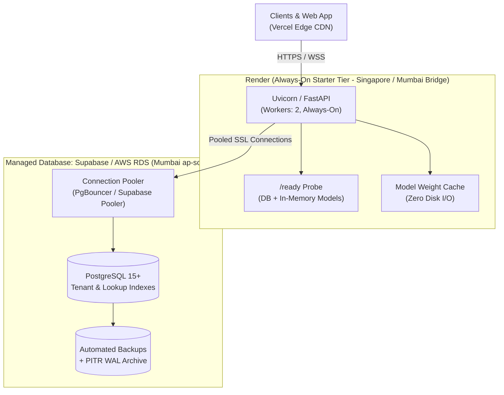

# Hosting, Infrastructure & High-Availability Architecture Guide

This guide documents the production infrastructure architecture for **TrustFed**, covering always-on zero-cold-start hosting, managed PostgreSQL in Indian regions, automated backups with point-in-time recovery (PITR), and dashboard action checklists.

---

## 1. Architecture Overview

---

## 2. Always-On Backend Hosting (Zero Cold Starts)

The free tier on hosting platforms like Render or Fly.io suspends applications after 15 minutes of inactivity, introducing 30–60 second cold start latencies. For clinical decision support, predictable sub-second response times are mandatory.

### Why "Starter" (or Standard) Tier is Required:
- **Zero Cold Starts**: The instance remains active 24/7/365.
- **Dedicated Memory (512 MB – 2 GB)**: Keeps the General Disease diagnostic weights and calibrated heart risk models cached in RAM.
- **Continuous Health Checking**: Render continuously pings `/ready`; if a container becomes degraded or unready, traffic is held until healthy or immediately failed over.

### Configured in Code & Config:
1. **`render.yaml` Blueprint**: Configured with `plan: starter`, `region: singapore` (closest to India, <60 ms round-trip), and `healthCheckPath: /ready`.
2. **Startup In-Memory Cache**: `backend/main.py` preloads `general_disease_model.get_model()` and `inference.load_model()` inside the `lifespan` handler so inference requires 0 disk reads.
3. **Connection Pooling**: `backend/db/database.py` pools database connections (`DB_POOL_SIZE=10`, `DB_MAX_OVERFLOW=20`, `pool_pre_ping=True`) avoiding repetitive TCP and TLS handshakes.

---

## 3. Managed PostgreSQL in an Indian Region

### Option A: Supabase South Asia (Mumbai) — Recommended
Supabase natively supports AWS Mumbai (`ap-south-1`):
1. **Region**: `ap-south-1` (Mumbai, India).
2. **Connection Pooler**: Connect through the Supabase connection pooler (`aws-0-ap-south-1.pooler.supabase.com:5432` for Session mode, `6543` for Transaction mode).
3. **Data Residency**: Complies with Indian DISHA and Digital Personal Data Protection Act (DPDP) data residency standards.

### Option B: AWS RDS / Aurora PostgreSQL (Mumbai `ap-south-1`)
1. Multi-AZ deployment across `ap-south-1a` and `ap-south-1b`.
2. PostgreSQL 15+ engine with automated snapshot retention.

---

## 4. Hosting Dashboard Action Checklist (For User)

### In the Render Dashboard (`dashboard.render.com`):
1. **Upgrade Plan**:
   - Navigate to `trustfed-backend` service -> **Settings** -> **Instance Type**.
   - Change from **Free** to **Starter** ($7/month).
2. **Set Health Check Path**:
   - In **Settings** -> **Health Check Path**, enter: `/ready`.
3. **Configure Environment Secrets**:
   - Under **Environment**, add the following sensitive secrets (do not commit to Git):
     - `SECRET_KEY`: High-entropy 64-character random hex string.
     - `JWT_KEY_RING`: `v1:<secret_key>` (or JSON map for key rotation).
     - `JWT_ACTIVE_KID`: `v1`.
     - `PATIENT_ENCRYPTION_KEY`: Fernet key generated with `python -c "from cryptography.fernet import Fernet; print(Fernet.generate_key().decode())"`.
     - `SUPABASE_DB_URL`: Pooler connection string pointing to your Mumbai database.
     - `MANAGED_DB_BACKUPS_CONFIRMED`: `true`.
     - `SECRETS_STORE_MANAGED`: `true`.

### In the Supabase Dashboard (`app.supabase.com`):
1. **Create/Verify Mumbai Project**:
   - Project Settings -> General -> Ensure Region is **South Asia (Mumbai) [ap-south-1]**.
2. **Connection Pooling**:
   - Database -> **Connection Pooling** -> Copy the IPv4 Pooler connection string (`aws-0-ap-south-1.pooler.supabase.com:5432`).
3. **Enable Point-In-Time Recovery (PITR)**:
   - Database -> **Backups** -> Enable **Point in Time Recovery**.
   - Supabase Pro retains continuous WAL logs for up to 7 days, allowing recovery to any exact second.
4. **Row Level Security (RLS)**:
   - Run `backend/db/migrations/enable_rls.py` or SQL editor to enforce RLS across all 16 tables.

---

## 5. What Was Changed in Code & Configuration

| Component | File | Changes Made |
| :--- | :--- | :--- |
| **Blueprint** | [`render.yaml`](file:///d:/projects/TrustFed/render.yaml) | Configured always-on `plan: starter`, `region: singapore`, `healthCheckPath: /ready`, connection pooling and secret mappings. |
| **Readiness Check** | [`backend/main.py`](file:///d:/projects/TrustFed/backend/main.py) | Added `/ready` and `/api/ready` verifying DB connection + ML models loaded in RAM; returns 503 if not ready. |
| **Liveness Hygiene** | [`backend/main.py`](file:///d:/projects/TrustFed/backend/main.py) | Sanitized `/health` so no connection credentials, exceptions, or hostnames can be leaked on failure. |
| **Model Preloading** | [`backend/main.py`](file:///d:/projects/TrustFed/backend/main.py) | Models preloaded once during startup lifespan; cached in memory for sub-10ms response times. |
| **Connection Pool** | [`backend/db/database.py`](file:///d:/projects/TrustFed/backend/db/database.py) | Configured SQLAlchemy connection pooling with `pool_size`, `max_overflow`, `pool_recycle`, and `pool_pre_ping`. |
| **Lookup Indexes** | [`backend/db/models.py`](file:///d:/projects/TrustFed/backend/db/models.py) | Added indexes on tenant columns (`hospital_id`, `hub_id`, `patient_id`), encounter dates (`created_at`, `confirmed_at`), and composite lookup indexes. |
| **Index Migration** | [`backend/db/migrations/v3_performance_indexes.py`](file:///d:/projects/TrustFed/backend/db/migrations/v3_performance_indexes.py) | Added `migrate_up` and `migrate_down` for safe rollback and upgrade. |
| **Key Rotation** | [`backend/services/crypto.py`](file:///d:/projects/TrustFed/backend/services/crypto.py) | MultiFernet key rotation keeping historical PHI readable while encrypting new records with primary key. |
| **JWT Rotation** | [`backend/services/auth.py`](file:///d:/projects/TrustFed/backend/services/auth.py) | Key ID (`kid`) based JWT signing and validation across keyring. |
| **Metrics Collector** | [`backend/core/metrics.py`](file:///d:/projects/TrustFed/backend/core/metrics.py) | Thread-safe collector for p50, p95, p99 endpoint latency metrics. |

